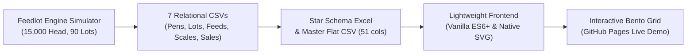

# Commercial Beef Cattle Feedlot Operations & Closeout Economics

[](https://wijaya-rama.github.io/portfolio-feedlot-management/)
[](LICENSE)
[](https://developer.mozilla.org/en-US/docs/Web/JavaScript)
[](data/)

> **Executive Beef Cattle Feedlot Analytics & Financial Ledger Dashboard** tracking operational performance, feeding efficiency, morbidity drags, carcass grading, and net margins across **15,000 commercial cattle**, **90 lots**, and **40 pens** in Southern Alberta, Canada over a 24-month operating cycle (2024–2025).

[Launch Interactive Dashboard (Live Demo)](https://wijaya-rama.github.io/portfolio-feedlot-management/)

---

## Executive Summary

Commercial cattle feeding in North America operates on razor-thin margins dictated by commodity price cycles, feed conversion efficiency, winter weather stress, and carcass grading grids. This project delivers an end-to-end quantitative investigation of **Highwood Feeders Ltd.**, a commercial feedlot operation in Southern Alberta, Canada.

Tracking 15,000 head placed between January 2024 and July 2025 (all closed out by December 2025), this analytics dashboard synthesizes daily pen bunk deliveries, sequential scale events, health treatments, and packer carcass settlement sheets into an integrated **Bento Grid Architecture** built with a **Takeaway-First Storytelling** methodology.

---

## Key Commercial Insights

```text
+-----------------------------------------------------------------------------------------+
|                                    CORE TAKEAWAYS                                       |
+---------------------------+---------------------------+---------------------------------+
|     Kilos vs. Grid        |    Winter Thermal Drag    |     BRD 30-Day Window           |
|     Charolais: $412/hd    |   Confinement Barn saves  |     78% of pulls in Days 1-30   |
|   11.8 kg heavier carcass |    +$49.82/head margin    |   Sick cattle leave 9.9 kg      |
|   beats Angus marbling    |    over open dirt pens    |   deficit ($103/hd drag)        |
+---------------------------+---------------------------+---------------------------------+
```

### 1. Kilos Beat Marbling: Charolais Tonnage ($412.85/hd) vs. Angus Grid Bonuses ($318.40/hd)
* **Black Angus** achieved superior marbling with **87.2%** of carcasses grading Canada Prime and AAA (capturing grid premiums up to +$0.35/kg).
* However, **Charolais Cross** delivered the top overall financial return (**$412.85/head net margin**, +$94.45/head higher than Angus) driven by high dressing yield (**61.8%** vs 60.8%) and **+11.8 kg heavier hot carcass weight (391.8 kg vs 380.0 kg)**. Heavy carcass tonnage consistently outweighed quality grade premiums under standard Canadian packer grids.

### 2. Alberta Winter Drag & Pen Shelter Economics (+$49.82/hd Barn Advantage)
* Sub-zero winter cold (mid-November to mid-March) forces cattle to divert dietary net energy from muscle gain toward thermal maintenance. Daily Dry Matter Intake (DMI) surged toward **14.76 kg/head/day** for heavy finishing cattle during sub-zero months, while average daily gain dropped by **14% to 20%**.
* Cattle housed in sheltered **Confinement Barns** mitigated wind chill penalties, maintaining superior feed conversion (**FCR 6.38 vs 6.74**) and securing **$372.10/head margin**, recovering **+$49.82/head** over exposed Open Dirt pens.

### 3. Clinical Morbidity & Critical 30-Day Pull Window (9.9 kg Permanent Deficit)
* Out of 15,000 cattle, **2,100 head (14.0%)** required therapeutic pulls, with **66.1%** diagnosed with Bovine Respiratory Disease (BRD). Over **78%** of all disease pulls concentrated within the first 30 days post-placement.
* Cattle that experienced morbidity suffered a permanent body weight deficit of **9.9 kg** at closeout and generated **$103.31/head lower net margin** ($241.90 vs $345.21 CAD) compared to cohort-mates that remained healthy. Sapi/cattle requiring repeat treatments accounted for **18% of all yard deaths**, confirming that chronic non-responders must be identified and culled before Day 45.

### 4. Feeder Procurement Arbitrage & Cattle Price Spread
* **Manitoba Foothills** calves provided the lowest purchase basis (**$5.63 CAD/kg live weight**), driving the highest origin margin (**$296.64 CAD/head**).
* Conversely, local **Southern Alberta** calves minimized transportation transit stress, recording the lowest morbidity rate (**13.41%** vs 14.65% in long-haul BC calves).
* Market timing proved decisive: **Q4 2024 placement lots** faced a double-squeeze from elevated feeder purchase costs combined with an October 2024 barley price spike (+15%), lifting Feed Cost of Gain to **$2.60/kg** and compressing margins to **$289.84/head**, before rebounding to **$341.54/head** in Q1 2025.

### 5. Skeletal Frame Score Value (Large Frame +$41.47/hd Edge)
* Cattle categorized with a **Large Frame** at placement outperformed **Medium Frame** animals across all key closeout indicators:
  * **Hot Carcass Weight:** 380.6 kg vs 373.3 kg (**+7.3 kg HCW**).
  * **Lifetime ADG:** 1.61 kg/day vs 1.57 kg/day.
  * **Net Margin:** $312.33 vs $270.86 CAD (**+$41.47 CAD/head margin advantage**).

---

## Strategic Feedlot Management Recommendations

| Strategic Operational Pillar | Target Metric | Recommended Field Intervention |
| :--- | :--- | :--- |
| **1. Feeder Procurement Mix** | 60% Exotic / 40% British | Allocate 60% of procurement to Charolais/Simmental crosses to capture carcass tonnage ($412 margin), reserving 40% for Black Angus when the AAA–AA grid spread widens. |
| **2. Winter Shelter Allocation** | Save $49.82/head cold drag | Prioritize lightweight incoming feeder calves (<310 kg) and Herefords into Confinement Barns during Oct–Dec placements to eliminate exposed cold stress. |
| **3. Early BRD Pulls & Bunk Reading** | Cap morbidity drag at < $110/hd | Enforce twice-daily bunk reading and pen riding during Days 5–25 post-arrival. Cull chronic non-responders before Day 45 to stop feeding unprofitable cattle. |
| **4. Pharmacoeconomic Regimen** | Minimize cost-to-cure | Maintain Tulathromycin as first-line defense for acute respiratory BRD (89.4% cure rate); utilize Oxytetracycline for foot rot cases ($53.20/case, 90.7% cure). |

---

## Data Architecture & Tech Stack



### 1. Data Modeling & Storage (`data/`)
* **`Feedlot_Management_StarSchema.xlsx` (7.9 MB):** Complete relational dimensional model containing 9 formatted worksheets, executive summaries, data dictionaries, and verified relationships:
  * **Dimension Tables:** `dim_pen` (40 rows), `dim_lot` (90 rows), `dim_cattle` (15,000 rows).
  * **Fact Tables:** `fact_feed_daily` (15,700 rows), `fact_scale_weights` (75,000 rows), `fact_health_treatments` (2,100 rows), and `fact_closeout_sales` (15,000 rows).
* **`Feedlot_Management_Flat_15000.csv` (6.6 MB):** Production flat table with 51 enriched fields (financial DOF, lifetime ADG, FCR, feed COG, dressing yield, CBGA carcass grade, net margin, and health flags).

### 2. Frontend Engineering & Design System
* **Zero External Dependencies:** Built entirely using **Semantic HTML5**, modern CSS variables, and **Vanilla JavaScript (ES6+)** — zero heavy npm packages or charting CDNs.
* **Native Scalable Vector Graphics (SVG):** Custom dynamic intake time series charts and scale trajectory curves rendered directly into the DOM with zero rendering lag.
* **Deterministic Dynamic Engine:** Every filter click (by Zone, Breed, Sex, Shelter) recomputes averages, margins, drug efficacy matrices, and lot report cards in under 2 milliseconds.
* **Dual Theme & Bilingual Toggle:** Instant theme switcher (Dark / Light) with WCAG AA compliance and bilingual localization (**English / Bahasa Indonesia**) backed by `localStorage` persistence.

---

## Repository Structure

```text
portfolio-feedlot-management/
├── index.html       # Production-ready interactive dashboard (GitHub Pages entry point)
├── .gitignore       # Git exclusion rules for OS, IDE, and temporary files
├── LICENSE          # MIT open-source license
├── README.md        # Executive portfolio documentation & business insights
└── data/            # Source data assets
    ├── Feedlot_Management_Flat_15000.csv       # Master flat ledger (15,000 rows, 51 columns)
    └── Feedlot_Management_StarSchema.xlsx      # 9-sheet relational dimensional model
```

---

## How to Run the Dashboard

### Option 1: Direct Local Execution (Instant)
Because this application is completely self-contained with no build steps or backend servers:
1. Clone this repository:
   ```bash
   git clone https://github.com/wijaya-rama/portfolio-feedlot-management.git
   cd portfolio-feedlot-management
   ```
2. Double-click [`index.html`](index.html) or open it with any modern web browser (Google Chrome, Microsoft Edge, Mozilla Firefox, Safari).

### Option 2: Run via Local HTTP Server
* **Using Python 3:**
  ```bash
  python -m http.server 8000
  ```
  Open `http://localhost:8000` in your web browser.
* **Using VS Code:**
  Right-click `index.html` and select **Open with Live Server**.

### Option 3: Host on GitHub Pages (Free Cloud Deployment)
1. Push this repository to your GitHub account under `portfolio-feedlot-management`.
2. In your GitHub repository, navigate to **Settings** > **Pages**.
3. Under **Build and deployment** > **Source**, select **Deploy from a branch**.
4. Set the branch to `main` and folder to `/ (root)`, then click **Save**.
5. Your interactive dashboard will be live at:
   `https://wijaya-rama.github.io/portfolio-feedlot-management/`

---

## Author & Contact

**Rama Wijaya**  
*Data Analyst | Commercial Quantitative Livestock & Business Intelligence*

* **LinkedIn:** [linkedin.com/in/ramawijaya1](https://www.linkedin.com/in/ramawijaya1)
* **GitHub:** [@wijaya-rama](https://github.com/wijaya-rama)
* **Portfolio Repo:** [portfolio-feedlot-management](https://github.com/wijaya-rama/portfolio-feedlot-management)
* **Live Dashboard:** [wijaya-rama.github.io/portfolio-feedlot-management](https://wijaya-rama.github.io/portfolio-feedlot-management/)

---

## License

This project is licensed under the [MIT License](LICENSE) — feel free to adapt and reference this project for commercial livestock analytics and portfolio benchmarking.
